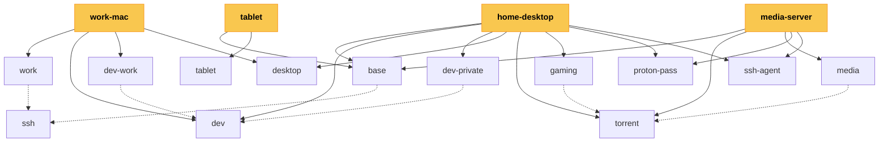

# Dotfiles

My dotfiles, managed with [mise bootstrap](https://mise.jdx.dev/bootstrap.html)
and [mise dotfiles](https://mise.jdx.dev/dotfiles.html). The checkout lives at
`~/.dotfiles`. The directory `~/.config/mise` links to `home/.config/mise` in
the checkout.

## Install

```sh
curl -fsSL https://raw.githubusercontent.com/smpte11/dotfiles/main/install.sh | sh
```

The installer installs mise, clones this repository to `~/.dotfiles` and runs
`dotfiles-setup`. On an interactive terminal, setup opens the gum picker
`home/.local/bin/dotfiles-choose`, which lists the modules from `modules.toml`.
Pick the modules for this machine; modules combine freely. Your choice is
written to `home/.config/mise/miserc.local.toml` (not committed), and
`mise bootstrap` runs. Re-run the installer or `mise run dotfiles:update` later
to add or remove modules; picking the same set again changes nothing. Setup
first offers to edit the raw profile file instead of using the picker
(`dotfiles-choose --edit` does the same standalone). Set
`DOTFILES_ENV=base,dev-private` to skip the questions.

## Modules

A module is one feature set: a `config.<name>.toml` file plus a
`[module.<name>]` entry in `modules.toml`. The `machine:` entries there pick a
full set for one machine: `work-mac`, `home-desktop`, `media-server` or
`tablet`. Example: `media-server` gives you `base`, `torrent`, `media`,
`proton-pass` and `ssh-agent`. `dev-private` and `dev-work` each pull in `dev`;
`media` and `gaming` each pull in `torrent`. Setup adds `ssh` to every machine
with an identity module.



## Secrets

- `proton-pass` (opt-in) installs `pass-cli` under
  `~/.local/share/proton-pass-cli/` and a `~/.local/bin/pass-cli` wrapper that
  picks a working key provider (D-Bus Secret Service, kernel keyring, or a
  filesystem fallback in headless environments), so `pass-cli login` works
  everywhere. Without the module, setup skips `pass-cli` and the login prompt,
  except on `torrent` machines, which read their keys from Proton Pass. A
  failed login does not abort the install: run `pass-cli login`, then
  `mise run dotfiles:update`.
- `ssh-agent` (optional) adds the Proton Pass SSH agent.
- `dev-private` passes the Codestral key to `mise bootstrap` as
  `CODESTRAL_API_KEY`. Change it by removing `~/.config/codestral/env` and
  running `mise run dotfiles:update`.
- `base` installs Vibe, pi and opencode, deploys `~/.vibe/config.toml` and
  `~/.config/opencode/opencode.json`, and renders `~/.vibe/.env` (0600) with
  `MISTRAL_API_KEY`, read from `pass://Personal/Vibe/API Key` with
  `proton-pass` or from the environment without it. mise loads the file with
  `redact = true`, so the key is never printed; pi and opencode read it as the
  Mistral provider key. Change it by removing `~/.vibe/.env` and running
  `mise run dotfiles:update`.
- On `torrent` machines, setup reads the `pass://Media/Netfelix/*` items and
  passes them to `mise bootstrap` as bootstrap secrets (`SONARR_API_KEY`,
  `RADARR_API_KEY`, `PROWLARR_API_KEY`, `QUESTARR_API_KEY`, `QBIT_USERNAME`,
  `QBIT_PASSWORD`, `YTS_API_URL`), falling back to the keys already deployed
  in the `config.xml` files. The media stack WebUI logins live as login
  entries in the Media vault (e.g. `pass://Media/qbittorrent`, which holds
  `QBIT_PASSWORD`), each with its API key as an `apiKey` extra field; the
  standalone `*_API_KEY` entries remain the bootstrap source.

## Layout

| Path | Deployed | Holds |
| --- | --- | --- |
| `home/` | always | Shared files, linked file by file into `~` |
| `ssh/` | `ssh` | `~/.ssh/config` |
| `base/` | `base` | Signing key, Vibe, pi, opencode, Proton VPN autostart |
| `dev/` | `dev` | k9s skin, tuios config; builds the tuios fork |
| `dev-private/` | `dev-private` | pi firstmate extension, Codestral key, crib config |
| `dev-work/` | `dev-work` | Claude keybindings |
| `proton-pass/` | `proton-pass` | `pass-cli` wrapper |
| `ssh-agent/` | `ssh-agent` | Proton Pass SSH agent, `~/.ssh/config.d/agent` |
| `work/` | `work` | 1Password agent, work identity |
| `desktop/` | `desktop` | Journal reminders, OpenDeck plugins and profiles |
| `torrent/` | `torrent` | netfelix pod, prowlarr, byparr, VPN-gated qbittorrent, Configarr config |
| `media/` | `media` | *arr quadlets, Configarr config, seed configs, media drive guard |
| `gaming/` | `gaming` | Questarr quadlets, config and timer |
| `home/.config/mise/config.toml` | always | Tools, groups, templates, repos |
| `home/.config/mise/config.<module>.toml` | per module | The module's vars, env, groups, services, hooks |
| `modules.toml` | no | Module catalog shown by the picker |
| `home/.config/mise/themes.toml` | | Palettes for the `*.tera` templates |

Files ending in `.tera` are templates. They read `vars` from the config and
the palette of `mise vars theme` from `themes.toml`. `switch-theme` runs
`mise run theme:switch [theme]` (a picker without a name) and writes
`home/.config/mise/conf.d/theme.toml` (git-ignored, tracked by mise history).
`mise dot rollback` of that file restores the previous theme.

## Media server (`torrent`, `media`, `gaming`)

The `torrent` module is the download stack that `media` and `gaming` share. It
deploys `netfelix.pod` to `~/.config/containers/systemd/netfelix/` with the
prowlarr and byparr quadlets, plus a headless qbittorrent quadlet on host
networking (WebUI on port 8081, config migrated from `~/.config/qBittorrent`).
Stop the host qBittorrent before the container takes the port. qbittorrent
mounts `vars.torrents_dir` at the same path inside the container: `/run/media/system/media/torrents`
with `media`, else `~/.local/share/torrents`. A `qbit-vpn-guard.service` user
unit runs qbittorrent only while the Proton VPN interface is up
(`vars.vpn_interface`, `proton0`) and pins `NetworkInterface` to it, so the
client cannot leak traffic when the VPN is down. A oneshot
`prowlarr-config.container` plus a daily timer apply
`torrent/configarr/config.yml` through Configarr. On non-work machines `base`
also installs the Proton VPN flatpak and `protonvpn-connect.service`, which
connects the CLI at startup and re-connects within a minute when the tunnel
drops (a disabled `proton.desktop` keeps the GUI out of the way).

`media` adds the *arr, Jellyfin and Seerr quadlets to the same pod and
publishes their ports through the drop-in `netfelix.pod.d/media.conf`. It
deploys the Configarr config to `~/.config/media/configarr/config.yml` and
seed `config.xml` files, only when missing, so existing installs keep their
keys. A oneshot `configarr.container` plus a daily timer apply the declarative
settings through the *arr APIs, including the prowlarr applications that sync
indexers to Sonarr and Radarr.

`gaming` deploys Questarr the same way (oneshot `questarr-config.container`
plus a daily timer applying `gaming/questarr/config.json` through the
admin-scope API), but with `Network=host`. Games live in
`~/.local/share/questarr/games`. Questarr mounts `vars.torrents_dir` at the
same path as qbittorrent and saves downloads to `torrents/questarr`, so
imports need no path mapping. One-time setup: create an `admin` API key in
Questarr (Settings -> API keys) and store it as
`pass://Media/Netfelix/QUESTARR_API_KEY`.

Secrets reach the containers as podman secrets, injected as environment
variables that `config.yml` reads with `!env`. A single post-dotfiles hook in
`home/.config/mise/config.toml` creates each secret once from its environment
variable, so modules that share a dependency (qbit for `media` and `gaming`)
use the same secret. Each module declares only the
`[bootstrap.secrets.*]` entries its containers consume. `media` also deploys
`~/.agents/machine/protect-media-drives.md`, which forbids agents from
touching the mounted media pool; machines read `~/.agents/machine/` files
before anything else.

## Everyday commands

- `mise run dotfiles:update` pulls the checkout and bootstraps again.
- `dotfiles-teardown [--yes]` removes the checkout, mise and everything
  deployed (asks without `--yes`).
- `mise dot status` lists what is deployed; `mise dot apply` deploys new
  files.
- `mise dot status --missing` exits with 1 when a file differs from the
  config; `mise dot diff` shows what `apply` would change.
- `mise dot edit <target>` opens the source of a deployed file, such as the
  `.tera` template of a rendered file.
- `mise run dotfiles:history [path]` browses saved checkpoints: preview each
  change, restore a checkpoint, undo an operation.
- `mise run deck:import` converts the Elgato Stream Deck profiles of this Mac
  into OpenDeck profiles of the `desktop` module (one set for macOS, one for
  Linux). Profile changes write through the symlinks into the checkout; key
  images are copied, so `mise dot add --changed` brings a changed image back.
- `mise run test:fresh` installs the repository in Linux containers (docker or
  podman) and checks it. Installs are saved as checkpoint images and reused
  until a file outside the checks changes; `--fresh` installs again. Each
  check group runs in its own container, e.g.
  `mise run test:fresh base --only theme,secrets`. `mise run test:clean`
  removes the images, checkpoints and caches. Run `test:fresh` locally before
  you push a change.
